# SKILL TREE — STORYBOARD FYP (kerangka: Design Thinking 10 langkah) (2026-11-15)

Sintesis dari 4 dokumen riset:
`STORYBOARD_FYP_GUIDE.md` (L0 rumus) → `STORYBOARD_FYP_FUNDAMENTALS.md` (L1 psikologi)
→ `STORYBOARD_FYP_DEEP.md` (L2 ekonomi/evolusi) → `STORYBOARD_FYP_GITHUB_INTEL.md` (presisi + ekosistem).

## Cara membaca tree

- **4 Tier = kedalaman** (L0 hafalan → L2 bisa karang ulang → operasional lolos gerbang).
- **10 langkah Design Thinking = harness** (pengujian), bukan urutan belajar. Setiap skill
  wajib lulus checkpoint DT-nya; skill tanpa checkpoint = belum jadi skill, cuma catatan.
- Arah panah mermaid = "menopang" (fundasi di bawah, rumus di atas).

## Peta tree

```mermaid
graph TD
  R["STORYBOARD FYP MASTERY"]

  subgraph T1["TIER 1 — GRAMMAR (rumus, bisa langsung dipakai)"]
    S1["S1 Hook Reflex<br/>frame-1 stimulus + hook ≤2s"]
    S2["S2 Gap Ladder<br/>curiosity ladder 2-30s"]
    S3["S3 Payoff Rhythm<br/>tiap 3-5s, teks 0.5/1.2s"]
    S4["S4 Pattern Interrupt<br/>tiap 3-4s"]
    S5["S5 Text System<br/>≤7 kata, safe zone"]
    S6["S6 Loop & Callback"]
    S7["S7 Cut Craft<br/>on motion, J-cut, no dead air"]
  end

  subgraph T2["TIER 2 — MEKANISME (kenapa rumus begitu)"]
    M1["M1 Prediction Violation<br/>hook = prediksi yang dilanggar"]
    M2["M2 Gap Economics<br/>buka-tahan-tutup, gap terlalu besar = menyerah"]
    M3["M3 RPE Payoff<br/>payoff > dugaan, janji dibayar ≤5s"]
    M4["M4 Anti-Habituasi<br/>intensitas monoton naik"]
    M5["M5 Load Budget<br/>1 ide/beat, teks≠transkrip, 160-175 WPM"]
    M6["M6 Arousal Arc<br/>1 emosi/video, CTA saat puncak"]
    M7["M7 Self-Reference Lock<br/>'ini tentang kamu'"]
    M8["M8 Social Packaging<br/>pihak+niat+konsekuensi"]
  end

  subgraph T3["TIER 3 — EKONOMI (adaptif lintas platform/format)"]
    E1["E1 Scent Management<br/>scent naik tiap detik"]
    E2["E2 Platform Objective<br/>completion 2× / saves / CTR"]
    E3["E3 Format Trichotomy<br/>faceless/face/carousel + 5-video rule"]
    E4["E4 Concept Economy<br/>satu kalimat × eksekusi ekstrem"]
  end

  subgraph T4["TIER 4 — EKOSISTEM (lolos gerbang distribusi)"]
    O1["O1 Account Gate<br/>warm-up 14 hari, durasi per fase"]
    O2["O2 Ban Defense<br/>trigger katalog + recovery"]
    O3["O3 Sound Velocity<br/>jendela 12-24 jam"]
    O4["O4 Funnel CTA<br/>search-by-name, pin comment"]
    O5["O5 Cohort Diagnosis<br/>seed 100-500, floor 65% @3s"]
  end

  R --> T1
  M1 -.menopang.-> S1
  M2 -.menopang.-> S2
  M3 -.menopang.-> S3
  M4 -.menopang.-> S4
  M5 -.menopang.-> S3
  M5 -.menopang.-> S5
  M6 -.menopang.-> S6
  M7 -.menopang.-> S1
  M8 -.menopang.-> S2
  T1 --> T2
  E1 --> T2
  E2 --> T3
  E3 --> T2
  E4 --> T2
  T3 --> T4
  O5 -.umpan balik.-> T1
```



## Harness: 10 langkah Design Thinking × skill (dengan checkpoint uji)

| DT Step | Skill yang diuji | Checkpoint lulus (bukti konkret) | Sumber |
|---|---|---|---|
| 1. Shapes | Rancang skema beat: `Beat{id,t,dur,shot,teks,vo,sfx,prediksi,tag}` + taksonomi error (`dead_air`,`hook_overrun`,`promise_unpaid`,`scent_flat`) | Storyboard 1 video: tiap baris punya durasi + 1 tag risiko; tidak ada beat "bebas" | GUIDE §3, INTEL §1 |
| 2. A dulu | Gambar beat-graph SEBELUM produksi: Hook→Setup→Payoff…→Loop | Graph 30s dengan 6 node + edge payoff; tidak ada node tanpa fungsi retensi | GUIDE §4, INTEL §5 |
| 3. Kardinalitas | Hitung aritmetika pacing: 1 hook / N payoff (3–5s) / 1 loop; WPM 160–175; cut 0,5–1s | Video 30s = 6–8 payoff terjadwal + jumlah kata VO pas WPM | FUND §1-5, INTEL §1 |
| 4. E | Tempatkan titik pecah + rencana cadangan: hook >2s→ganti; dead air→SFX; janji belum dibayar @5s→bocorkan partial | Tiap beat punya kolom "kalau gagal: X" | FUND §5, INTEL §6 |
| 5. R | Deklarasi kebutuhan per beat: aset visual, sound (cek velocity), teks, CTA aset | Sound dipilih dengan bukti "accelerating di niche, belum di list publik" | INTEL §2b |
| 6. Boundary | Perlakukan input eksternal sebagai untrusted: referensi niche (5-video rule), fakta diverifikasi, sound post-peak ditolak | Mining niche: top-20 video dikatalogkan, 5+ struktur sama → dipakai skeleton-nya | INTEL §2, heymaya §7 |
| 7. Behavior wrap | Uji murah sebelum mahal: animatic (sketsa+VO) → checklist retensi → A/B hook (50 thumbnail versi MrBeast) | Animatic lolos 9-poin checklist GUIDE sebelum render | GUIDE §6, mrbeast-skill |
| 8. Scope | Kunci scope: 9:16, durasi per fase akun (15–30s discovery), palet ≤3, safe zone 250/130/150px | Frame test: teks/CTA tidak menyentuh zona terlarang | INTEL §2c-2d |
| 9. Swap R | Verifikasi via proxy murah: stick figure > polish; rough hand-shot > cinematic untuk akun baru; Personal acct > Business acct (30-60 hari) | Keputusan format punya alasan ekonomi, bukan selera | INTEL §2d, heymaya §4 |
| 10. A/E terpisah | Jalur sukses bersih dari recovery: shadow-ban sequence (stop 48h → check → setengah cadence), jangan delete-and-repost, revisi beat di layer terpisah | Ada runbook tertulis untuk 3 kegagalan terumum | INTEL §6, heymaya §9 |

## Jalur belajar (urutan dependensi, 4 level)

```
Minggu 1  S1-S7 (grammar)  — hafal + pakai template GUIDE; checkpoint DT 1-3, 8
Minggu 2  M1-M8 (mekanisme) — tulis ulang 10 hook lama memakai alasan M; checkpoint DT 4
Minggu 3  E1-E4 (ekonomi)  — remap 1 video ke 3 platform; pilih format via 5-video rule; checkpoint DT 5-6, 9
Minggu 4  O1-O5 (ekosistem) — jalankan warm-up/cadence + baca grafik cohort 3 video; checkpoint DT 7, 10
```
Tes total: satu video diproduksi end-to-end dengan semua checkpoint tertandai.

## Sinyal mastery (bukti di data, bukan perasaan)

- L0: hook baru lolos checklist tanpa lihat dokumen.
- L1: bisa menjelaskan KENAPA hook kompetitor gagal dengan istilah mekanisme (bukan "kurang menarik").
- L2: diberi platform baru → bisa menurunkan sendiri rumusnya dari fungsi objektif platform.
- L3: grafik retensi 3 video terakhir bisa dibaca → titik drop → penyebab → perbaikan beat berikutnya.

## Untuk akun @develaparx (persona software engineer, 8 video, FYP gelombang-2)

Path prioritas: M7 + M8 dulu (konten resonansi kerja = self-reference + social packaging alami),
lalu E3 (validasi format via 5-video rule di niche #ngoding/#animasiai),
lalu O5 (diagnosa drop-off video-7/8), terakhir O3 untuk sound. E4 dipakai saat menulis seri "what if".
Catatan: carousel (Photo Mode) belum teruji di niche ini — uji 3 slide sebelum dipercaya angka 1.9×/2.9×/2.6×.

---

# CABANG C — SKILL TREE CERITA × PLATFORM (append 2026-11-15)

## Aturan penurunan mapping (dari fundamental, bukan hafalan)

Cerita cocok di platform X bila lolos 2 klausul:
1. **Kurva cerita cocok dengan fungsi objektif platform** (apa yang platform hadiahkan menentukan
   bentuk arc: completion → cliffhanger rapat; saves → resolusi memuaskan; CTR/search → jawaban
   query + frame-1 thumbnail; AVD → stair-stepping panjang).
2. **Bungkus = format native niche** (5-video rule): skeleton yang menang di niche, isi ditukar.
Kalau klausul 1 gagal, cerita "bagus" pun tidak terdistribusi; kalau klausul 2 gagal, drop-off di detik-2.

## Matriks cerita × platform (✓✓ native / ✓ jalan / — melawan arus)

| Cerita | TikTok | Reels | Shorts | YT long | X/Threads | Mekanisme (kenapa) |
|---|---|---|---|---|---|---|
| Storytime sosial/konflik (pihak+niat+konsekuensi) | ✓✓ | ✓ | ✓ | ✓ | ✓ | Makanan spesies (Dunbar); cliffhanger = completion |
| POV resonansi ("kamu juga kan?") | ✓✓ | ✓ | ✓ | — | ✓ | Self-reference lock; niche-native TikTok |
| Edu kontra-intuisi singkat | ✓✓ | ✓✓ | ✓✓ | ✓ | ✓ | Violation hook bekerja di semua; ditahan 25s |
| Transformasi before→after | ✓✓ | ✓✓ | ✓ | — | — | Kontras visual + saves di Reels; legible tanpa konteks |
| Satisfying/ASMR proses | ✓✓ | ✓✓ | ✓ | — | — | Audio-narrative; tanpa bahasa; completion tinggi |
| Tutorial langkah (3–5 step) | ✓ | ✓✓ | ✓✓ | ✓✓ | — | Searchable = Shorts; save-able = Reels; long = YT |
| Build-in-public (progres terlihat) | ✓✓ | ✓ | ✓ | ✓ | ✓✓ | Tugas terbuka Ovsiankina; X = habitat aslinya |
| Hot take/kontroversi terbela | ✓ | ✓ | ✓ | — | ✓✓ | Arousal tinggi → share; wajib bukti ≤8s |
| What-if spekulatif | ✓✓ | ✓ | ✓✓ | ✓ | ✓ | Violation besar ber-scaffolding; loop-friendly |
| Carousel edukasi/listicle | ✓ | ✓✓ | — | — | ✓ | 1.9×/2.9×/2.6× vs video (perlu uji niche); B2B/dev native |
| Meme/trend-jack sesaat | ✓✓ | ✓ | — | — | ✓✓ | Velocity window; usia pendek = tak cocok search |
| Dokumenter/challenge besar | — | — | — | ✓✓ | — | AVD + stair-stepping; patch biaya-masuk tinggi |

## Node skill cabang C (checkpoint DT per node)

```mermaid
graph TD
  subgraph CBRANCH["CERITA × PLATFORM"]
    C1["C1 Storytime Sosial<br/>TikTok/YT"]
    C2["C2 POV Resonansi<br/>TikTok"]
    C3["C3 Transformasi Visual<br/>Reels"]
    C4["C4 Edu-Search Authority<br/>Shorts/YT"]
    C5["C5 Build-in-Public<br/>X/TikTok"]
    C6["C6 Carousel Edukasi<br/>IG/TikTok Photo"]
    C7["C7 What-If Spekulatif<br/>TikTok/Shorts"]
    C8["C8 Hot Take Terlindungi<br/>X/TikTok"]
    M1["M1 Prediction Violation"] -.menopang.-> C7
    M1 -.menopang.-> C8
    M7["M7 Self-Reference"] -.menopang.-> C2
    M8["M8 Social Packaging"] -.menopang.-> C1
    M3["M3 RPE Payoff"] -.menopang.-> C3
    O5["O5 Cohort Diagnosis"] -.umpan balik.-> CBRANCH
  end
```

| Node | Definisi skill | Checkpoint Design Thinking (lulus = bukti) |
|---|---|---|
| C1 Storytime Sosial | Cerita konflik/kisah pribadi ber-pihak, arc 15–60s | Shapes: ada pelaku+niat+konsekuensi per beat; A: cliffhanger di ~40% dan ~75% durasi; E: kalau flat, ganti sudut pihak (bukan tambah detail) |
| C2 POV Resonansi | Menyengat kebiasaan spesifik audiens ("kalau kamu …") | Shapes: subjek selalu "kamu" bukan "orang"; Boundary: perilaku yang disebut benar-benar umum di niche (cek komentar/kompetitor) |
| C3 Transformasi Visual | Before→after legible tanpa konteks | A: beat-1 before penuh, beat-akhir after; Swap R: transisi diuji di animatic dulu; Scope: palet konsisten (Reels estetika) |
| C4 Edu-Search Authority | Jawab query nyata niche, evergreen | R: riset kata kunci (search bar TikTok/YouTube) sebelum nulis; A: frame-1 = thumbnail-worthy; Kardinalitas: 1 pertanyaan per video |
| C5 Build-in-Public | Progres bertahap sebagai tugas terbuka | Shapes: angka progres di hook ("hari ke-12"); E: video "gagal" tetap posting (belajar > gagal-posting); A: tiap episode punya status berubah |
| C6 Carousel Edukasi | 6-slide structure (problem→context→twist→proof→outcome→CTA) | Shapes: 1 ide/slide; Scope: 9:16, kontras tinggi, native text; Boundary: slide-1 = hook 1 kata tebal |
| C7 What-If Spekulatif | Premis 1 kalimat × konsekuensi nyata | A dulu: turunkan 3 konsekuensi berantai dari premis; M1: premis melanggar prediksi umum tapi ada anchor fakta; E4: konsep ≤10 kata |
| C8 Hot Take Terlindungi | Klaim kontrarian yang DIBELA cepat | E: bukti pertama muncul ≤8s; Boundary: klaim tidak melanggar fakta (anti-clickbait, bayar janji); M6: satu emosi (biasanya marah/tegas) dipuncakkan |

## Mapping khusus @develaparx (software engineer, niche #ngoding #whatif #animasiai)

| Cerita | Status di niche ini | Catatan eksekusi |
|---|---|---|
| POV resonansi kerja dev | ✓✓ sudah terbukti akun (video-8 ×32) | C2 + M7: sebut kebiasaan dev spesifik (debug jam 2 pagi, code review, deploy Jumat) |
| What-if spekulatif | ✓✓ tag #whatif 1,4M reach 59,5× | C7: seri "what if komputer berhenti 1 hari" — anchor fakta + konsekuensi berantai |
| Screen-record demo/edukasi | ✓✓ format native niche dev | heymaya: niche dev tools jalan di screen recording, bukan talking-head |
| Carousel dev-tips | ✓ uji dulu | uji 3 post Photo Mode sebelum percaya angka boost |
| Build-in-public | ✓ kalau mulai proyek terbuka | C5 + X cross-post (habitat asli) |
| Storytime karier dev | ✓ untuk variasi | C1: pihak (kamu vs bug vs deadline), niat, konsekuensi |
| Meme/trend-jack dev | ✓ sesekali | hanya saat sound/format accelerating (jendela 12–24 jam) |

